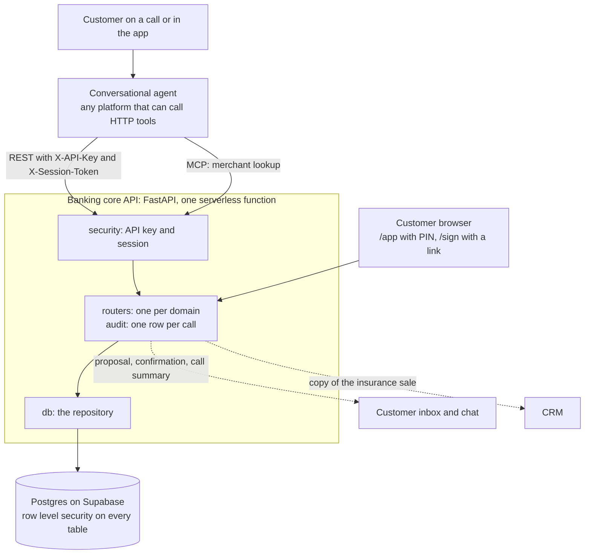

# Magallanes banking core

[](https://github.com/fabotics/magallanes-banking-core/actions/workflows/ci.yml)
[](LICENSE)


A mock banking core API for Banco Magallanes, a fictional Latin American retail bank. It is built to be called by conversational agents as tools: verify a customer, read balances and card transactions, block a card, open a case for a person, check insurance eligibility, record an offer and send a proposal to sign.

It also serves the customer's side of those conversations: a small mock of the bank's phone app at `/app`, where the customer approves an identity confirmation and reads and signs the insurance contract.

> **This is not a real bank, and all data is fictional.** Banco Magallanes does not exist. Every customer, document number, card, phone number, merchant and policy in this repository and on the live demo is invented for demonstration. No real money or personal data is involved. It is a portfolio project, not a product.

| | |
| --- | --- |
| Live API documentation | https://magallanes-banking-core.vercel.app/docs |
| Live customer app | https://magallanes-banking-core.vercel.app/app |
| Health check | https://magallanes-banking-core.vercel.app/health |
| Test customers | [Seed customers](#seed-customers) |
| Run and test it | [Run it locally](#run-it-locally), [Tests](#tests) |
| Use it from an agent | [Connecting an agent](#connecting-an-agent) |
| Security | [SECURITY.md](SECURITY.md) |
| Releases | [CHANGELOG.md](CHANGELOG.md) |

The live API answers `/v1` requests only with its API key, which is not public. `/docs` shows every endpoint, and the tests in this repository show each one working.

## Why it looks the way it does

A language model follows a prompt most of the time. A bank needs rules that hold all of the time. So the rules that matter are enforced by the API, not left to the agent.

| Rule | How the API enforces it |
| --- | --- |
| Identity before data | Every customer endpoint needs a session token issued by identity verification. No token, HTTP 401 |
| Identity is proven in the bank's app first | A confirmation request goes to the customer's app and expires in 90 seconds. Data said aloud on a call is the fallback, because someone else may know it too. The confirmation code is never returned by the API, so an agent cannot read it out |
| Short sessions | A session lasts 15 minutes and belongs to one customer |
| Limited attempts | Three failed verifications for a document within 15 minutes lock it. Denied app confirmations and failed spoken checks count together |
| Only reversible actions | The only state change on a card is a temporary block. No endpoint moves money |
| Eligibility is the bank's decision | The API computes which insurance products may be offered, from country, segment, policies held and the vulnerable flag. An offer for anything else is refused |
| Consent is recorded | Every offer and the customer's answer is stored. A sale is signed by the customer on a page, not by voice |
| A sale is real only when signed | The proposal reaches the customer at once, by email and in their chat, so they can sign during the call. The agent can read whether it was signed, with the policy number and start date, and can never sign for them. Sent, viewed and signed each leave an audit row, and the signature row records the language and a fingerprint of the contract shown |
| Never a dead end | A handoff case can be opened without a verified session, with no customer data attached |
| Everything is recorded | Every `/v1` and `/mcp` call writes an audit row. Tokens and full document numbers are never logged |
| Only known callers | Every `/v1` and `/mcp` call needs the API key |

## Architecture



The agent holds the conversation and nothing else. It calls this API for every fact and every action, and the API decides what is allowed. The customer proves identity and signs in the bank's app, never by voice alone.

Stack: Python 3.12, FastAPI, Postgres on Supabase through the `supabase` client, Jinja2 for the customer pages, the MCP Python SDK for the merchant lookup tool, pytest and ruff. Hosted as a single serverless function.

All database access goes through one small repository interface in `app/db.py`. The tests replace it with an in-memory version loaded with the same seed data, so they need no network.

```
app/
  main.py              app factory, routers, middleware
  config.py            settings from the environment
  security.py          API key check, session check
  audit.py             audit middleware
  db.py                repository: every database call
  errors.py            one error shape: {"error", "message"}
  confirmations.py     identity confirmation requests answered in the bank's app
  app_session.py       the customer app: PIN check, lock, session cookie
  waiting.py           how long a status request is held, and what to do next
  quotes.py            the premium and limit the bank's rules give one customer
  statement.py         card movements in words: day, hour, repeated charges
  overview.py          the profile and recent movements returned with a verification
  closing.py           the bank's own summary when a conversation ends without one
  crm.py, crm_sync.py  optional copy of the insurance sale to the CRM
  pins.py              PIN hashing
  contracts.py         builds the contract per product and language, fingerprint, signature checks
  contract_es.py, contract_en.py   the contract wording
  i18n.py, texts_es.py, texts_en.py   language choice and the sentences of the customer pages
  email.py             optional emails, sent through an HTTP API
  notices.py           what the bank writes to the customer, in Spanish and English
  signature.py         what happens when a proposal is seen and signed
  formatting.py        amounts and dates as the customer reads them
  messaging.py         optional messages to the customer over Telegram
  mcp_server.py        MCP endpoint with the merchant lookup tool
  clock.py             one way to read and write timestamps
  schemas.py, schemas_identity.py, schemas_cases.py, schemas_insurance.py,
  schemas_notifications.py   request and response models
  routers/             identity, identity_push, customers, accounts, cards, cases, insurance,
                       proposals, registry, notifications, signing,
                       app_auth, app_pages, app_contract, app_assistant, brand, review
  templates/           sign.html (signing link) and app/ (the customer app)
db/schema.sql          tables, checks, indexes, row level security
seed/                  fictional customers and transactions, dated relative to today
scripts/               seed.py, smoke_test.py, mcp_check.py and four crm_*.py
dashboard/             metrics.py and the Streamlit page
tests/                 one file per area, plus the in-memory repository
```

## Data model

| Table | Purpose |
| --- | --- |
| `customers` | Who the bank knows: document, name, segment, language, vulnerable flag, and the hashed PIN of their app |
| `accounts` | Balances per account |
| `cards` | Cards and their status: active, blocked_temporary, blocked |
| `transactions` | Card movements as on a statement: a cryptic descriptor, sometimes a merchant tax ID, never a merchant name |
| `insurance_products` | The catalog, with the segments each product is open to |
| `policies` | Who holds which product, with the policy number and the proposal that was signed |
| `quotes` | The premium and limit the bank's rules give one customer for one product, valid 15 days |
| `insurance_offers` | Every offer made and the customer's answer. The consent record |
| `proposals` | Proposals sent, with their signing token, status, and when they were viewed and signed |
| `cases` | Fraud cases, handoffs, complaints, callbacks and meetings, numbered `MG-<year>-<sequence>`. Each is a service case or a sales lead |
| `verification_sessions` | Proof that identity was verified, with an expiry |
| `verification_attempts` | Used by the lockout rule, for both identity paths |
| `identity_confirmations` | Requests to confirm identity in the bank's app: code, status, expiry |
| `app_sessions` | Signed-in sessions of the customer app, ten minutes each |
| `audit_log` | One row per API call: endpoint, customer, conversation, outcome |
| `registry_merchants` | Stand-in for the public company registry: the business behind a merchant tax ID |

Row level security is enabled on every table with no policies, so only the server-side key can read or write.

## Endpoints

Interactive documentation is served at `/docs` ([live](https://magallanes-banking-core.vercel.app/docs)): every endpoint has a description and an example body, and the Authorize button takes the API key.

| Method and path | Session | Purpose |
| --- | --- | --- |
| GET `/health` | no | Liveness and database status |
| POST `/v1/identity/push` | no | Ask the customer to confirm their identity in the bank's app. Name them by `customer_ref` (a conversation started inside the app), by `phone` (the caller's number, matched to the phone on file) or by `customer_id` (the national ID number they say). Returns a `request_id`, pending for 90 seconds. A caller may send both `customer_ref` and `phone`, whatever its channel carries: the bank uses the one that names a customer, and answers `not_identified` when neither does, so the caller asks for the ID number at once |
| GET `/v1/identity/push/{request_id}` | no | pending, approved, denied or expired. Once approved it returns the session token and `overview`: the customer's profile and the card movements of the last 30 days, so the caller does not ask for them one by one. `wait` (0 to 20 seconds) holds the request while it is pending. The bank counts the checks: the first request of a conversation is held twice, a later one once, and after that the answer comes at once. `next_step` says what to do: `check_again`, `send_new_confirmation` or `offer_other_way`, with the same in a sentence in `instruction` |
| POST `/v1/identity/verify` | no | Fallback: verify by document, card digits and birth year, and open a session |
| GET `/v1/customers/me` | yes | First name, segment, language, products held |
| GET `/v1/accounts/balance` | yes | Available balance per account |
| GET `/v1/cards/transactions` | yes | Recent card movements, newest first. `days` (default 30), `status` (all, pending, posted). Every movement carries the day and hour it was made on the bank's clock, in words (`purchased_on`, `purchased_time`, `posted_on`), and `repeated_charges` counts and adds up charges that share a descriptor, so a caller never works out a weekday or a total |
| POST `/v1/cards/block` | yes | Temporary block. Returns a reference |
| GET `/v1/cases/routes` | no | How the customer can reach a person right now: at once (needs a phone line and service hours), a callback, or a meeting |
| POST `/v1/cases` | handoff: optional | Fraud case, handoff, complaint, callback or meeting, as a `service` case or a `sales_lead`. Returns a case number |
| GET `/v1/insurance/eligibility` | yes | Products the bank pre-approves, each with a personal quote (number, premium, limit per event, valid until), or the reason there are none |
| POST `/v1/insurance/offers` | yes | Record an offer and how it ended. `outcome` is `sent` (the customer wants the proposal), `interested` (they want to read it first) or `declined`, with a `loss_reason` for a no: `not_interested`, `price`, `already_insured` or `other`. The older `customer_response` (accepted, declined, info_requested) still works |
| POST `/v1/insurance/proposals` | yes | Create the proposal for an offer and send it by email and to the customer's chat. It is a contract to sign whether the customer accepted or asked for the details: signing is what accepts. Asking again sends the same proposal again. `valid_until` is the last day to sign, 15 days like the quote |
| GET `/v1/insurance/proposals/{proposal_id}` | yes | `proposal_id` is the proposal number. pending, signed or expired. Once signed: the policy number and the start date. `wait` (0 to 20 seconds) holds the request while it is unsigned |
| POST `/v1/cards/review` | yes | Record the customer's answer after their charges were explained: `recognised` or `not_recognised`. A doubt or a question is neither, and no case is opened on one |
| POST `/v1/cases/{case_number}/withdraw` | yes | Take back a case the customer no longer needs, for example one opened before they recognised the charges. Closes it, clears the dispute on its charges and closes its copy in the CRM |
| POST `/v1/notifications/call-summary` | yes | Send a written summary of the call to the customer's messaging channel (Telegram) |
| POST `/v1/notifications/conversation-ended` | no | The caller's platform says a conversation is over (`conversation_id`, at the top level or inside `data`). If the agent sent no summary, the bank writes its own from what it recorded: cases, card blocks, proposals, policies |
| GET `/v1/registry/merchants/{tax_id}` | no | The business behind a merchant tax ID |
| `/app` and `/app/...` | PIN | The customer app, described below |
| GET, POST `/sign/{token}` | no | Signature page, in Spanish or English. Signing creates the policy and sends the customer a confirmation |
| POST `/mcp` | no | MCP server with one tool, `lookup_merchant`. Same key, in `X-API-Key` or as a bearer token |

The session token goes in the `X-Session-Token` header (preferred). It is also accepted as a `session_token` query parameter on GET and as a `session_token` body field on POST.

Errors always have the same shape:

```json
{"error": "identity_not_verified", "message": "Verify the customer's identity before this request."}
```

Example:

```bash
curl -X POST http://localhost:8000/v1/identity/verify \
  -H "X-API-Key: $BANK_API_KEY" -H "Content-Type: application/json" \
  -d '{"document_number": "31.415.926-8", "card_last4": "4821", "birth_year": 1986}'
```

```json
{"verified": true, "locked": false, "session_token": "...", "first_name": "Marta"}
```

A wrong answer never says which field was wrong:

```json
{"verified": false, "locked": false, "attempts_remaining": 2}
```

## The customer app

`/app` is a mock of the bank's phone app, rendered by the API as plain HTML and CSS. It exists so that the two steps a bank will not take by voice can be shown end to end: proving identity and signing a contract.

| Screen | What it does |
| --- | --- |
| PIN | Four digits. Three wrong PINs lock the app for one minute. Before the PIN only the first name is shown |
| Home | Name, masked card, and what is waiting: identity confirmations and proposals to sign |
| Identity confirmation | The code of the request, with approve and deny. Anything but an explicit approval is a denial |
| Contract | Four numbered pages: particulars, cover, exclusions, general conditions. Initials on each page, the full name typed as the signature, a final confirmation. The server checks all three |
| Result | Policy number and start date. The same details go out by email and to the chat |
| Assistant | Talk to the bank from inside the app. Only behind the PIN, and only when a conversation widget is configured. Confirmations and proposals the assistant sends show up on the same screen |

On a wide screen the app is drawn inside a phone frame; on a phone it fills the screen. The look is the bank's own: a deep green-blue, ice and a copper accent, with the Southern Cross as the mark.

The pages exist in Spanish and English. Spanish is the default, `?lang=en` in the link opens them in English, a switch on every screen (the PIN screen and the signing link included) changes it, and the choice lasts for the visit. The contract has the same pages and clauses in both languages. Messages and emails follow the language of the call: the caller sends `language` (`es` or `en`) when it asks for a confirmation, sends a proposal or sends the call summary, and without it the language on file for the customer is used. Links in a message carry the same language, so the page opens in the language of the message. The confirmation of a signature is written in the language the contract was read and signed in.

A signature records what was read: the audit row of `proposal_signed` carries the language the contract was shown in and a SHA-256 fingerprint of that exact wording, and the result screen shows the start of the fingerprint.

Every page wears the bank's brand: the symbol in the header, the lockup on the first page of the contract, and colours that come from one block of tokens (`app/templates/app/_brand.html`). The icons and the web manifest live in `app/static/brand` and the app serves them at the root (`/favicon.ico`, `/site.webmanifest` and the rest).

Signing in works like a bank's phone app. The first visit to `/app` asks for the ID number and the four digit PIN, and never says which of the two was wrong. After a sign-in the browser remembers the customer (a cookie that holds no secret and opens nothing), so the next visit greets them by first name and asks for the PIN only, with a link to sign in as someone else. Logging out forgets the customer and returns to the full form. If `BANK_PHONE_LINE` is set, the sign-in screen also shows the bank's phone line as a tap-to-call link, for someone who cannot or does not want to sign in. Links sent to the chat name the customer (`/app?u=<customer id>&next=<page>`), so they open on the PIN screen too. Three wrong PINs lock the app for one minute, whichever screen they were typed on. Every seed customer can sign in: `python scripts/seed.py --pins` prints their PINs. A session lasts ten minutes in an `HttpOnly`, `SameSite=Lax` cookie, pages are sent with `Cache-Control: no-store`, and redirects never leave `/app`.

The assistant screen does not contain a vendor's widget. `ASSISTANT_EMBED_HTML` holds the embed snippet of whichever conversation widget is used, and the app replaces `{variables}` in it with `{"channel": "app", "channel_identity": "<customer id>"}`, and `{customer}` with the customer id alone, for a widget that takes the reference as an attribute of its own. With that, the agent can send the identity confirmation to this app without asking for a document number (`identity/push` with `customer_ref`). The reference only says where the confirmation goes: the approval behind the PIN is still what verifies the customer. A production app would hand the widget a short-lived signed token minted by the bank's server instead of a plain reference. The app also replaces `{lang}` with its own language (`es` or `en`), so the widget speaks the language of the screen, and the ES and EN switch reloads it in the other one. The widget lives in a frame that fills the Assistant view, between the header and the menu: closed, it is a card under the introduction; open, it takes the whole view. It can never cover the header or the menu, and it exists on the Assistant tab only. What the assistant sends is drawn on top of the conversation. Once the Assistant view is open, the conversation survives moving around the app: links and forms are fetched and only the content of the page is replaced (`app/templates/app/_stay.html`), so the frame with the call is never reloaded. Signing out and changing language still load a new page.

PINs are not in this repository. The seed script derives each customer's PIN from `APP_PIN_SECRET` and stores only a salted PBKDF2 hash. `python scripts/seed.py --pins` prints them for whoever holds the secret.

## CRM sync

The bank core is the record that counts. When a CRM is configured, each step of the insurance sale is also copied to Salesforce, from the API itself, right after the bank has stored it. The agent has no CRM tool for the sale and never hears about the copy: a failure is logged, written on the audit row of the call (`crm: failed`), and changes no answer.

| What happens at the bank | What appears in the CRM |
| --- | --- |
| A customer is verified, by the app or by the spoken check | A Contact, found by `Customer_Reference__c` (the customer's reference). First name, last name and country only: no document number, email or phone |
| An offer is logged | A Lead named after the customer, with the product as its company, and an Opportunity: in stage `Offered` when the customer wants the proposal, `Interested` when they want to read it first. Amount is the yearly premium (the quoted monthly premium times 12) and the close date is the last day of the quote. The Opportunity also carries what a card on a sales board shows: the contact's name, the monthly premium, the quote number, the day of the last activity, and the channel when the bank knows it (App or Phone, from how the customer was named at the start) |
| The customer says no | The Opportunity is created `Declined`, with the `Loss_Reason__c` the caller passed |
| The proposal is sent | Stage `Proposal Sent`, with the proposal number. A customer who only wanted to read it first stays `Interested` |
| The customer signs, in the app or on the signing link | Stage `Signed`, with the policy number and the day of the signature as close date |

The sales process has five stages and no others, in this order: Offered, Interested, Proposal Sent, Signed (won), Declined (lost).

Every record carries the lead source `Voice agent`. Records are found by external IDs (`Customer_Reference__c`, `Offer_Reference__c`), so a repeated call updates and never duplicates. The code is two small modules: `app/crm.py` signs in with the OAuth 2.0 client credentials flow and sends requests with an eight second limit, and `app/crm_sync.py` says what is copied at each step.

Set `SALESFORCE_INSTANCE_URL`, `SALESFORCE_CLIENT_ID`, `SALESFORCE_CLIENT_SECRET` and `SALESFORCE_API_VERSION` (see `.env.example`). Without the instance URL nothing is sent, so tests and local runs stay offline. Three scripts go with it:

```bash
python scripts/crm_setup.py         # once per org: the five stages, lead source, fields, permission set, list views
python scripts/crm_seed.py          # about 400 fictional customers across the funnel; --wipe removes them
python scripts/crm_check.py         # one whole sale, in memory at the bank, checked in the CRM itself
python scripts/crm_cleanup.py       # deletes the demo customer's Opportunity and Lead, keeps the Contact
```

`crm_setup.py` makes the five stages the only active ones (the org's default stages are switched off), adds the fields above plus `Seeded__c`, and a list view "Voice agent funnel" for opportunities and leads, newest first. Its first four columns are what a card shows when the view is displayed as a board. `crm_seed.py` invents its customers (names from two lists that never repeat, document numbers from a range that was never issued, no emails or phones) and spreads about 400 offers over the last 90 days: 55% declined, 15% offered, 10% interested, 8% with a proposal, 12% signed, the open ones mostly from the last two weeks. Records are created with the date of their offer, so every week has some. Every record is marked `Seeded__c = true`, and running the script again replaces the seeded funnel. `crm_check.py` verifies the main demo customer, logs the offer, sends the proposal and signs it, and after each step reads the Opportunity back: the stages must be Offered, Proposal Sent, Signed, and the signed sale must be the first row of the list view.

## Run it locally

You need Python 3.12 and a Supabase project (the free tier is enough).

```bash
python3.12 -m venv .venv
source .venv/bin/activate
pip install -r requirements-dev.txt
cp .env.example .env
```

Fill `.env`: the Supabase project URL, its secret key (not the publishable one), the Postgres connection string, and a `BANK_API_KEY` and an `APP_PIN_SECRET` of your own (`openssl rand -hex 32` for each).

Create the tables, load the seed data and start the API:

```bash
set -a; source .env; set +a
psql "$SUPABASE_DB_URL" -f db/schema.sql
python scripts/seed.py --reset
uvicorn app.main:app --reload
```

`python scripts/seed.py --reset` wipes every table and reloads the seed. If `DEMO_CUSTOMER_EMAIL` and `DEMO_TELEGRAM_CHAT_ID` are set, the three demo customers (Daniel and Emma, who speak English, and Marta, who speaks Spanish) get them, so proposals, confirmations and call summaries reach you. If `DEMO_CUSTOMER_PHONE` is set, it becomes the phone on file for Daniel, so a call from that phone is matched to him. Dates are relative to the day it runs, so the story is always recent. It also clears verification attempts, pending confirmations, proposals and app sessions, and restores every app PIN, which unlocks a locked customer.

### Seed customers

| Customer | Document | Card | Birth year | Story |
| --- | --- | --- | --- | --- |
| Daniel | 35.628.194-2 | 5519 | 1992 | English speaker living in Santiago. Sees five charges dated Monday and bought nothing on Monday: five rounds at one restaurant and bar on Saturday night, posted together. Eligible for insurance, premium segment |
| Emma | 35.897.932-7 | 6302 | 1988 | English speaker living in Santiago. Sees five charges dated Monday and bought nothing on Monday: five rounds at one restaurant and bar on Saturday night, posted together. Eligible for insurance, premium segment |
| Marta | 31.415.926-8 | 4821 | 1986 | Sees four charges dated Monday and bought nothing on Monday: four rounds at one restaurant on Saturday night, posted together. Eligible for insurance |
| Pedro Pablo | 32.718.281-1 | 7730 | 1979 | Two online charges at night from abroad, in dollars |
| Carolina | 33.161.803-9 | 1164 | 1991 | Already holds the card product |
| Jorge | 30.577.215-1 | 9052 | 1948 | Flagged as vulnerable: offers go to a human advisor |
| Lucia | 34.141.421-0 | 3378 | 1995 | Her card is already blocked |

Five more customers in Peru, Colombia and Mexico use other document types and currencies. The insurance catalog is available in Chile only, so they get `eligible: false` with the reason `not_available_in_country`.

## Tests

```bash
ruff check .
ruff format --check .
pytest -q --cov
```

The tests run on an in-memory repository and need no network or `.env`. There are 280 of them and they cover 97% of the lines of `app/`, `seed/` and the dashboard metrics. The same checks run on every pull request, together with an audit of the dependencies for known vulnerabilities and a CodeQL scan, and the build fails if coverage drops below 90%.

`make help` lists the common tasks: `install`, `run`, `test`, `lint`, `format`, `seed`, `smoke` and `audit`.

To check a running instance end to end:

```bash
python scripts/smoke_test.py --base-url http://localhost:8000
```

## Operations dashboard

A small Streamlit page shows how the agent is doing, computed only from the bank core's own tables (audit log, cases, offers, proposals). It reads; it never writes.

| Group | Metrics |
| --- | --- |
| Resolution | Conversations, share with identity verified, share resolved by the agent (verified and no case needed), verifications locked |
| Escalation | Share escalated to a person, cases opened by type, cards blocked |
| Offers | Offers made, share of verified conversations that got an offer, acceptance rate, proposals sent and signed |

A conversation is every API call that shares one `conversation_id`. The numbers are computed in `dashboard/metrics.py`, which has its own tests.

```bash
pip install -r dashboard/requirements.txt
streamlit run dashboard/streamlit_app.py
```

It uses the same `.env` as the API. Streamlit is only needed for this page, so it is not in `requirements.txt` and is not part of the deployed API.

## Deploy

The API runs on Vercel as one Python function with no extra configuration: `app/main.py` exports `app`, dependencies come from `requirements.txt`, and `.python-version` selects Python 3.12.

1. Import the repository as a new Vercel project. Production branch: `main`.
2. Set the environment variables: `SUPABASE_URL`, `SUPABASE_SECRET_KEY`, `BANK_API_KEY`, `APP_PIN_SECRET` and `PUBLIC_BASE_URL` (the production URL, used to build the links sent to customers). Everything else in `.env.example` is optional and switches a feature on: email, chat messages, the phone line, the conversation widget, the CRM copy.
3. Deploy, then run the smoke test against the production URL.

## Connecting an agent

Each endpoint maps to one webhook tool on any agent platform that can call HTTP APIs.

- Store `BANK_API_KEY` as a secret on the platform and send it in `X-API-Key` on every tool.
- Verify identity in the app first. If the channel already says who the customer is, send that to `identity/push` and ask for nothing: `customer_ref` for a conversation started inside the app, `phone` for a call. Otherwise ask for the document number and send it as `customer_id`. Keep `request_id`, tell the customer to approve the request in the app, and read the result with `wait=20` straight away: the answer arrives the moment the customer approves, so they never have to say they did. Read it at most a few times; if it stays pending, or comes back denied or expired, fall back to `identity/verify`. `push` answers the same for a document the bank does not know, so the agent learns nothing from it. An ID number said aloud arrives with noise (`35628194@, uh, -2`): the bank reads it with and without the letters and keeps the reading it knows. A conversation has one verified customer: a second verification in the same conversation ends the first session, and every later call is for the customer verified last.
- After either path, keep `session_token` for the rest of the conversation and send it in `X-Session-Token`.
- Pass the platform's conversation ID as `conversation_id` when verifying. The API then ties every later call, case and offer to that conversation.
- Keep `offer_id` from `offers` to request the proposal, and read `case_number` and block `reference` back to the customer.
- After `proposals`, tell the customer where the link is and that nothing is active until they sign. If they sign while still on the call, read the proposal status with `wait=20` and confirm the policy number and start date as soon as it says signed. The catalog is written in Spanish, so in Spanish the agent says names, cover and prices as they come. In English it uses the wording of the English contract.
- `transactions` waits about one second before answering, like a legacy system would. Have the agent say something while it waits.
- At the end of the conversation, send a short `call summary`. The API delivers it to the channel the bank has on file and answers `sent: false` when there is none.
- `eligibility` returns a quote per product. The premium and the limit are computed by the bank's rules from the customer's segment and age (`app/quotes.py`): the agent reads them out and never changes them. The quote number is kept on the offer, the proposal and the contract.
- The card product covers only what the law does not already place on a card issuer (cash stolen after a withdrawal, emergency money, replacing documents, assistance). Refunding unauthorized charges is the issuer's own duty and is never sold as insurance.
- When `eligibility` answers `eligible: false`, the agent makes no offer. When `verify` answers `locked: true` or `push` answers `status: locked`, the agent opens a handoff case.
- Before offering a person, read `cases/routes`. Offer to connect the customer at once only when `talk_now` is available; otherwise offer a callback (ask for a time window) or a meeting (ask for a day and time). A wish to buy or quote something is a `sales_lead`; a problem is a `service` case.
- A handoff for a caller who is not verified has no session token to send. If your platform refuses a tool call when a header variable is empty, give that handoff its own tool without the `X-Session-Token` header.

### Merchant lookup over MCP

The merchant registry is also offered as an MCP tool, for platforms that connect to MCP servers.

| Setting | Value |
| --- | --- |
| URL | `<base url>/mcp` |
| Transport | Streamable HTTP, stateless, JSON responses |
| Authentication | `BANK_API_KEY` as a bearer token, or in the `X-API-Key` header |
| Tool | `lookup_merchant(tax_id)` returns `found`, `trade_name`, `legal_name`, `category` and `city` |

An unknown tax ID answers `found: false` with a message, not an error. The core banking endpoints stay on plain REST on purpose: only public reference data is exposed over MCP.

Each request builds its own MCP server and shuts it down when the answer is sent, so the endpoint does not rely on a startup hook and works on serverless hosting.

```bash
python scripts/mcp_check.py --base-url http://localhost:8000
```

## Roadmap

- Cases mirrored to the CRM, next to the insurance sale.
- A signature on the `conversation-ended` notice, and rate limits per caller.
- A short-lived signed token for the conversation widget in place of the plain customer reference.

## License

MIT. See `LICENSE`.
